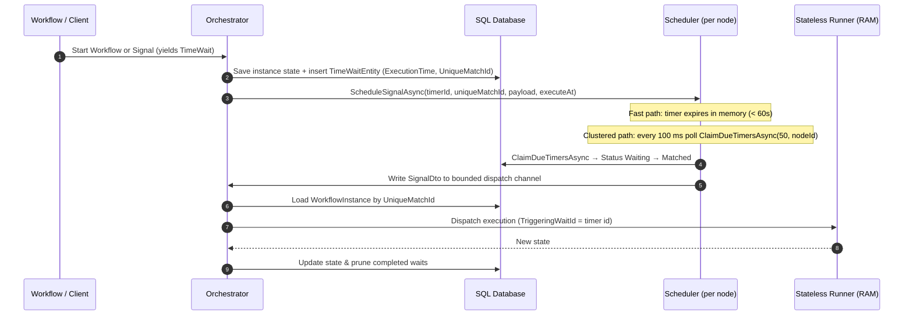

# Orchestrator-Side Distributed Timer Scheduling

This document describes how `TimeWait` timers are scheduled and fired by the Workflows engine. The shipped implementation is a **native, database-backed clustered timer engine** ([Scheduler.cs](../../Workflows.Orchestrator/Scheduler.cs)); it deliberately has **no Quartz.NET or Hangfire dependency**.

---

## 1. Problem Statement & Limitations

An in-memory-only timer dictionary has critical limitations for production:

* **Volatility**: restarting the hosting process wipes pending timers (`TimeWait` instances), leaving active workflows permanently stuck.
* **Single-Point Failure**: multiple engine nodes cannot coordinate, leading to duplicate executions or missed triggers.
* **No Persistence**: timers decoupled from SQL transactions create drift between active waits and in-memory timer records.

---

## 2. Target Architecture

The engine combines a **near-term in-memory fast path** with a **clustered database poller**, and dispatches every fired timer through a bounded channel:



---

## 3. Database Schema

Timers are stored in the `TimeWaits` table (`TimeWaitEntity : WorkflowWaitEntity`).

| Column | Type | Description |
| :--- | :--- | :--- |
| **Id** | Guid/string (PK) | The unique `TimeWait` identifier generated by the Runner. |
| **WorkflowInstanceId** | Guid (FK) | Owner workflow instance ID. |
| **UniqueMatchId** | String | Correlation path used as the signal identifier when the timer fires (e.g. `OrderProcessingWorkflow_Timer`). |
| **ExecutionTime** | DateTime (UTC) | Absolute UTC time at which the timer must expire. Computed at mapping time as `DateTime.UtcNow + TimeWait.TimeToWait`. |
| **Status** | Int | `WaitStatus.Waiting` (100) → `WaitStatus.Matched` (200) once claimed, then pruned when the workflow advances. |

There is no `SchedulerJobId` column: the timer's own `Id` *is* the identity used for cancellation.

---

## 4. Component-Level Design

### 4.1 Contract

```csharp
public interface IExternalScheduler
{
    Task ScheduleSignalAsync(Guid timerId, string signalIdentifier, object payload, DateTime executeAt);
    Task CancelScheduledSignalAsync(Guid timerId);
}
```

`Scheduler` implements both `IExternalScheduler` (fast path) and `IHostedService` (poll + dispatch loops).

### 4.2 Two-Tier Execution

| Tier | Trigger | Details |
| :--- | :--- | :--- |
| **In-memory fast path** | `ScheduleSignalAsync` | Timers are held in a `ConcurrentDictionary<Guid, TimerRecord>` and swept every 100 ms. Suitable for short delays (< 60 s) where the owning node is still alive. |
| **Clustered DB poller** | `RunTimerLoopAsync` | Every 100 ms calls `IWorkflowStore.ClaimDueTimersAsync(50, nodeId)`, which selects `Status == Waiting && ExecutionTime <= now`, ordered by `ExecutionTime`, and transitions each row to `Matched` in the same `SaveChanges` call. Because the claim query filters on `Waiting`, a timer claimed by node A is invisible to node B's next poll. |

Claimed and expired in-memory timers are both written to a **bounded `System.Threading.Channels.Channel<SignalDto>`** (default capacity 1000, `FullMode = Wait`) and consumed by a single dispatch loop that resolves a scoped `IOrchestrator` and calls `ProcessSignalAsync`. This applies backpressure to the orchestrator instead of flooding it during a timer storm.

### 4.3 Node Identity

Each `Scheduler` instance creates `_nodeId = "{MachineName}_{Guid:N}"`. It is passed to `ClaimDueTimersAsync` and exposed as `NodeId` for diagnostics.

### 4.4 Stale Claim Recovery

If a node crashes after claiming a timer (status `Matched`) but before the workflow advances, the timer would be stranded. Every 30 seconds the poll loop calls:

```csharp
await store.RecoverStaleTimersAsync(TimeSpan.FromMinutes(5), cancellationToken);
```

which resets `Matched` timers whose `ExecutionTime` is older than the threshold back to `Waiting`, letting any node re-claim them. `NativeDistributedTimerTests` covers both the claim and the recovery paths.

---

## 5. Timer Cancellation & Pruning

When a workflow completes early, is cancelled, or a `MatchAny` branch wins:

1. **Detection** — the Runner identifies cancelled waits and reports their IDs in its execution result.
2. **In-memory removal** — the orchestrator calls `IExternalScheduler.CancelScheduledSignalAsync(timerId)`, removing the record from the node's in-memory dictionary.
3. **SQL clean-up** — the `TimeWaits` row is deleted as part of the save transaction that applies the new state, so a cancelled timer can no longer be claimed.

Cancellation is node-local: `CancelScheduledSignalAsync` only clears the calling node's fast path. The database row is authoritative, which is why pruning the row (step 3) is what actually prevents a cancelled timer from firing.

---

## 6. Known Gaps

* `ClaimDueTimersAsync` claims by status transition plus a sequential `SaveChanges`; it does not yet issue `SELECT ... FOR UPDATE SKIP LOCKED`, `rowversion` checks, or record the claiming `nodeId` on the row. Two nodes polling in the same instant can read the same due row before either writes — the current guard is the status filter plus the test-observed sequential re-poll, not a DB-level lock.
* `RecoverStaleTimersAsync` uses `ExecutionTime` (not a claim timestamp) to decide staleness, so a long-delayed-but-legitimately-slow timer can be re-queued.
* The 60-second fast-path threshold is documentation-level guidance; `Scheduler` currently registers every scheduled timer in memory regardless of delay.