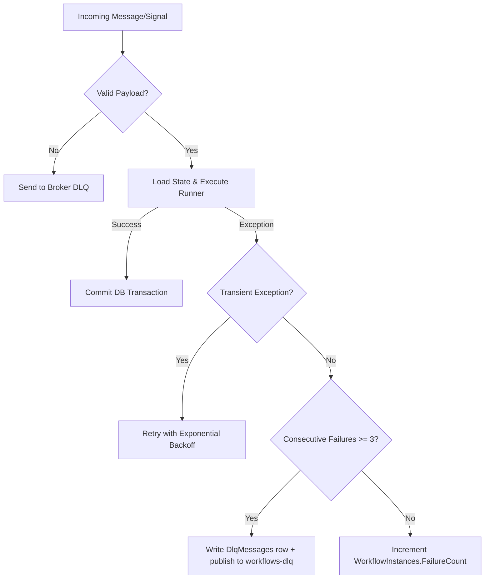

# Poison Message & Dead Letter Queue (DLQ) Handling

> **Status: 🟡 Partially implemented.** The DLQ data model, publisher contract and SQL schema exist, but the failure counter is not yet incremented and nothing calls `IDlqPublisher` at runtime. Section 6 lists the exact gaps.

This document specifies how **poison messages** and repeated workflow execution failures are isolated without blocking processing queues.

---

## 1. Safety Boundaries

The engine distinguishes three classes of failure:

1. **Transient Faults**: network timeouts, database lock contention, broker reconnects — resolved through retries.
2. **Structural Poison Messages**: malformed payload JSON, missing headers, validation failures — retrying will always fail.
3. **Application Code Faults**: unhandled exceptions inside a workflow's C# `Run` method (e.g. `NullReferenceException`).

---

## 2. Failure Handling Architecture (target design)



---

## 3. Data Model

### 3.1 `WorkflowInstances.FailureCount`

A dedicated `FailureCount` column (default `0`) tracks consecutive unhandled failures per instance. It is intended to be reset on a successful commit, so only *consecutive* failures trip the guardrail.

### 3.2 `DlqMessages`

`Workflows.Storage.EntityFrameworkCore.DlqMessageEntity` maps the outbox-style DLQ table:

| Column | Type | Description |
| :--- | :--- | :--- |
| `Id` | `long` (identity) | Surrogate key. |
| `WorkflowInstanceId` | `Guid` | FK to `WorkflowInstances` (`ON DELETE CASCADE`). |
| `WorkflowType` | `string` | Fully-qualified workflow type name. |
| `FailureCount` | `int` | Failure count at the moment of DLQ routing. |
| `PayloadJson` | `string?` | Serialized JSON of the signal/command result that triggered the last failure. |
| `ErrorMessage` | `string?` | Last unhandled exception message. |
| `CreatedAt` | `DateTime` (UTC) | When the entry was created. |
| `Status` | `int` | `0` = Pending (not yet forwarded), `1` = Forwarded. |

Indexes: `IX_DlqMessages_Status_CreatedAt` (sweeper polling) and `IX_DlqMessages_WorkflowInstanceId` (per-instance queries).

The schema script lives at [`DataStore/AddFailureCountAndDlqMessages.sql`](../../DataStore/AddFailureCountAndDlqMessages.sql) and includes SQLite, SQL Server and PostgreSQL variants of the identity column.

---

## 4. Publisher Contract

```csharp
namespace Workflows.Abstraction.Persistence
{
    public class DlqMessage
    {
        public Guid     InstanceId    { get; set; }
        public string   WorkflowType  { get; set; } = string.Empty;
        public int      FailureCount  { get; set; }
        public string?  PayloadJson   { get; set; }
        public string?  ErrorMessage  { get; set; }
        public DateTime FailedAt      { get; set; }
    }

    public interface IDlqPublisher
    {
        Task PublishAsync(DlqMessage message);
    }
}
```

`Workflows.Orchestrator` registers `NoOpDlqPublisher` by default, so no broker configuration is required out of the box. To forward entries to a real bus (RabbitMQ, Azure Service Bus, Kafka), register your own implementation:

```csharp
services.AddSingleton<IDlqPublisher, RabbitMqDlqPublisher>();
```

The intended order of operations is: persist the `DlqMessages` row (transactional with the instance state) **first**, then publish to the `workflows-dlq` broker queue. A sweeper can then retry rows whose `Status` is still `0`.

---

## 5. Broker-Level vs Database DLQ

| Layer | When | Behaviour |
| :--- | :--- | :--- |
| **Broker DLQ** | The orchestrator cannot parse or validate a message *before* running the workflow | Reject (NACK, `requeue = false`); the broker routes the message to `workflows-dlq`. |
| **Database DLQ** | Execution fails after the instance was loaded | Persist a `DlqMessages` row, publish via `IDlqPublisher`, and stop re-dispatching the instance until it is reviewed. |

---

## 6. Remaining Work

1. **`WorkflowInstance.FailureCount`** — the column exists in the SQL script but is *not* mapped on the `WorkflowInstance` entity.
2. **`DlqMessages` DbSet** — `WorkflowsDbContext` does not expose `DlqMessageEntity` yet, so the table is unused by EF Core.
3. **Increment / reset** — nothing increments `FailureCount` on failure or resets it on success (`CoordinatorCommitWorker` / `InboxOrchestrator` are the natural call sites).
4. **Threshold transition** — no code sets `WorkflowInstanceStatus.InError` (there is no `Suspended` status; the enum defines `New`, `InProgress`, `Completed`, `InError`, `Canceled`, `Running`).
5. **Publisher invocation** — `IDlqPublisher.PublishAsync` is never called; wire it into the failure path after the DLQ row is committed.
6. **Sweeper** — there is no worker that reads `Status = 0` rows and forwards them to the broker.
7. **Administrative recovery** — there is no `Suspended` state and no `ResumeInstanceAsync` API. Recovery today means correcting the payload or workflow code and letting the instance continue; a dedicated admin action is still to be designed (`Workflows.Admin.UI` exposes cancel/compensate, not resume).